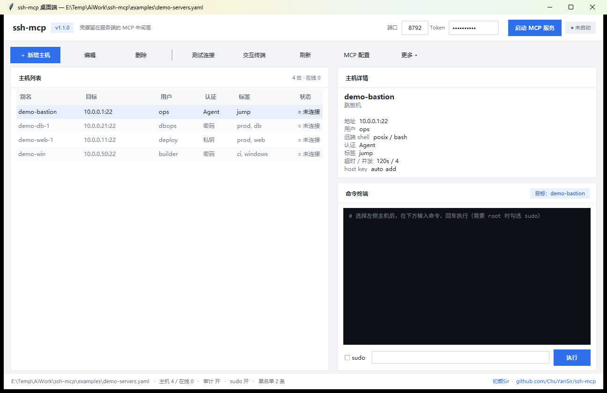
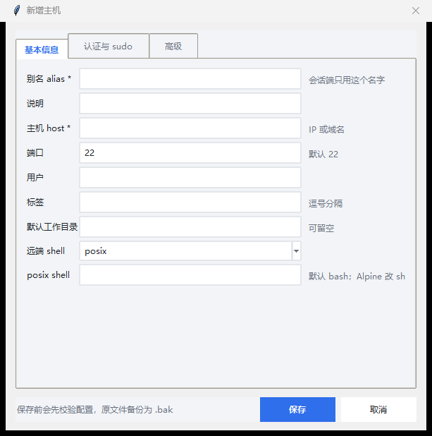
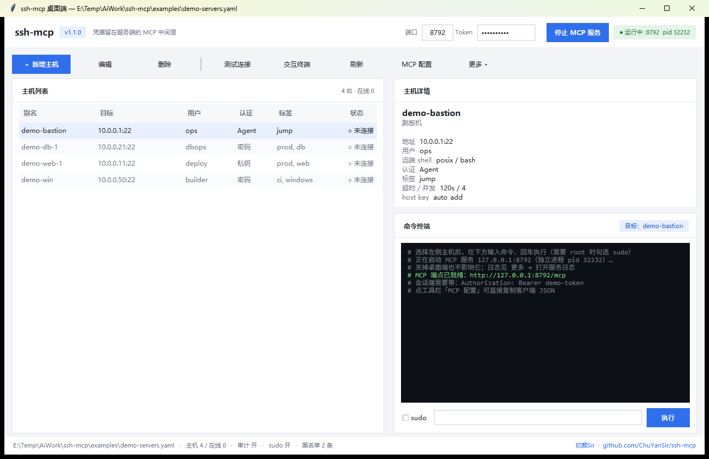
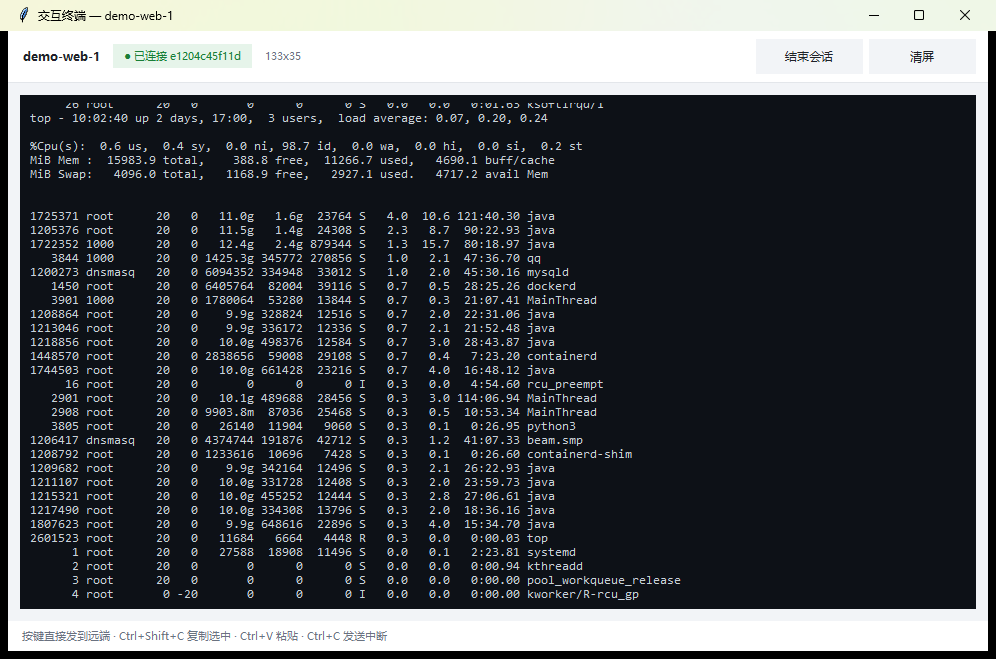
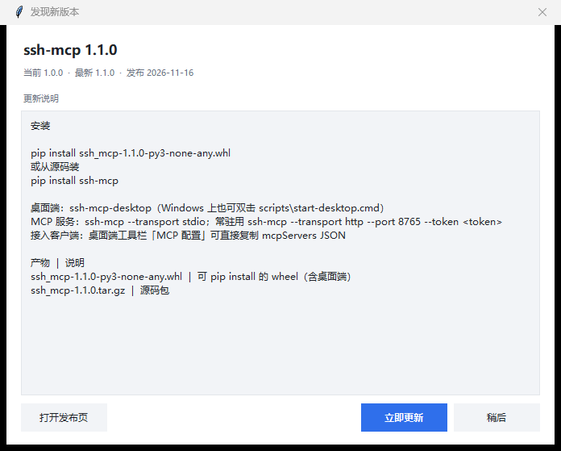

# ssh-mcp

把 SSH 凭据收进一个中间服务：客户端会话只拿 `alias` 就能执行命令，**永远看不到用户名、密码、私钥**。
配了一个原生桌面端（tkinter，无浏览器、无 Electron），增删主机就是在窗口里填表。

> **作者**：[初颜Sir](https://github.com/ChuYanSir) · chuyansir@163.com
> **仓库**：<https://github.com/ChuYanSir/ssh-mcp> · **版本**：v1.2.2

[](https://github.com/ChuYanSir/ssh-mcp/actions/workflows/ci.yml)
[](https://github.com/ChuYanSir/ssh-mcp/actions/workflows/release.yml)
[](https://github.com/ChuYanSir/ssh-mcp/releases)

桌面端「更多 → 关于 ssh-mcp」和状态栏右下角都带有作者与仓库地址：


```
        ┌──────────────┐    MCP (stdio / HTTP)     ┌──────────────────┐   SSH    ┌──────────────┐
        │  会话端 A     │ ────────────────────────▶ │                  │ ───────▶ │ prod-web-1   │
        │  会话端 B     │   只传 alias + command    │     ssh-mcp      │ ───────▶ │ prod-db-1    │
        │  会话端 C     │ ◀──────────────────────── │  (凭据 + 连接池)  │ ───────▶ │ bastion → 内网 │
        └──────────────┘   exit_code/stdout/stderr  └──────────────────┘          └──────────────┘
                                                          ▲
                                              ┌───────────┴────────────┐
                                              │ 桌面端：配置 / 测试 / 执行 │
                                              │ servers.yaml + 凭据文件   │
                                              └────────────────────────┘
```

---

## 1. 快速开始（桌面端）

**双击** `scripts\start-desktop.cmd`，或：

```powershell
cd E:\Temp\AiWork\ssh-mcp
.\.venv\Scripts\pythonw.exe -m ssh_mcp.desktop
# 指定配置：... -m ssh_mcp.desktop --config D:\ssh\servers.yaml
```

首次启动会自动创建 `servers.yaml`（在 cwd 或 `~/.ssh-mcp/` 下），窗口左侧是空的，点「新增主机」填表即可。
不需要装任何 GUI 依赖，Windows 自带 Python 的 tkinter 就够（本机已修好 venv 的 tkinter 支持）。



---

## 2. 桌面端能做什么

| 区域 | 能力 |
|---|---|
| 左侧列表 | 别名 / 目标 / 用户 / 认证方式 / 标签 / **在线状态**（已连上的标绿） |
| 工具栏 | 新增主机、编辑、删除、**测试连接**、刷新、打开配置、打开凭据目录、**MCP 配置**（复制客户端 JSON） |
| 主机详情 | 地址、认证方式、密码来源标记（`file:…` / `env:…`，**不回显密码**）、sudo、超时、host key 策略、跳板机 |
| 命令终端 | 选一台主机直接跑命令，stdout / stderr / `[exit N]` 时间一次看全，支持 sudo 勾选 |
| 右上角 | MCP 端口 + Token + **启动/停止 MCP 服务**（同一进程内起，客户端会话直接连） |
| 状态栏 | 配置路径、主机数、在线数、审计开关、策略摘要 |



编辑对话框分三个页签：**基本信息 / 认证与 sudo / 高级**（core 字段、私钥或密码、凭据存储位置、
sudo 用户与密码、shell 类型、超时、host key 策略、跳板机）。

### 写入配置的四个保险

1. 保存前先在临时文件跑一遍 `load_config()` 校验，**通过才落盘**；
2. 覆盖前自动备份 `servers.yaml.bak`；
3. 密码默认不落明文：写到 `~/.ssh-mcp/creds/<alias>.pass`，yaml 里只留 `password_file`；
4. 保存后自动热重载配置 + 重建连接池，不用重启。

密码字段可选三种存储位置：**凭据文件（默认）/ 环境变量 / 直接写 yaml**；编辑时留空 = 保持原凭据。

### 桌面端和 MCP 服务的关系

桌面端是**遥控器**：点「启动 MCP 服务」会以**独立进程**拉起

```
python -m ssh_mcp --transport http --host 127.0.0.1 --port <端口> --config <servers.yaml> [--token <token>]
```

端点 `127.0.0.1:<端口>/mcp`。由此得到三个结果：

- **关掉桌面端窗口不影响服务** —— 客户端可以一直连着用；pid 记在 `~/.ssh-mcp/service.json`，
  下次打开桌面端会自动发现「● 运行中 :8765  pid 1234」并把按钮切成「停止 MCP 服务」。
- **改配置不用重启服务** —— 服务每次处理工具调用前比一下 `servers.yaml` 的 `(mtime, size)`，
  变了就自动重读并后台关掉旧连接。所以桌面端里新增一台主机，客户端下一次调用
  `ssh_list_hosts` 就能看到，不需要点「停止 / 启动」，也不需要手动 `ssh_reload_config`。
  配置文件写到一半（非法 YAML）时会保留旧配置、把错误记进 `ssh_status().autoload.last_error`，
  修好后自动恢复。
- 关闭窗口时如果服务在跑，会问一句「要顺便把服务也停掉吗？」，选否就留着；
  服务日志在 `~/.ssh-mcp/logs/service.log`（更多 → 打开服务日志）。



启动成功时：按钮变成「停止 MCP 服务」、右上角亮绿灯 `● 运行中 :端口 pid N`、
终端面板打印端点地址和会话端该带的 `Authorization: Bearer …`。
端口/token 会记在 `~/.ssh-mcp/desktop-ui.json`，下次开窗口自动回填。

不想开桌面窗口时，也可以用命令行方式跑服务（见下节）。

### 一键复制客户端配置

工具栏「MCP 配置」给出两段可直接粘贴的 JSON，各带一个「复制」按钮：


- **HTTP（服务模式，推荐）**：`type: streamable-http` + `url` + `Authorization: Bearer <token>`。
  客户端连上后用的就是桌面端这个进程里的凭据与连接池；服务没启动时这里标黄提示。
- **stdio（不用常驻服务）**：`command` 指向 venv 的 `python.exe`（不是 `pythonw.exe`），
  `args` 里带 `--config` 的绝对路径，由客户端自己拉起子进程。

点「复制」后直接粘进客户端的 `mcpServers`（DeepSeek Harness / Claude Desktop / Cursor 都认这个结构）。
如果客户端把类型写成 `http` / `streamable_http`，改 `type` 的值即可，`url` 与 `headers` 不用动。

---

## 3. 当成常驻服务用

```powershell
# HTTP（常驻，多会话共用一套凭据与连接池）
.\scripts\start-http.ps1                     # 自动生成 token，打印地址
.\scripts\start-http.ps1 -NoAuth             # 本地回环自用，免 token
.\scripts\start-http.ps1 -Port 9000 -Token xxx

# stdio（客户端自己拉起子进程，适合单会话）
.\.venv\Scripts\python.exe -m ssh_mcp --transport stdio --config servers.yaml

# 只校验配置解析（不连接，凭据已脱敏）
.\.venv\Scripts\python.exe -m ssh_mcp --config servers.yaml --print-config
```

| | 桌面端 | HTTP 服务（桌面端拉起或 `start-http.ps1`） | stdio |
|---|---|---|---|
| 图形界面 | ✅ 唯一的图形入口 | ❌ 纯 MCP 端点 | ❌ |
| 进程 | GUI 进程 | **独立进程，关 GUI 不影响** | 客户端拉起 |
| 连接池 | 自己的（测试/终端用） | 自己的，多会话共享 | 各进程独立 |
| 适合 | 本机运维/管理 | 团队共用一台跳板 | 单机单 Agent |

> HTTP 模式只暴露 `/mcp` 一个端点，根路径返回 404——**没有网页后台**，
> 所有配置、测试、执行都在桌面端做。

配置文件查找顺序：`--config` → `SSH_MCP_CONFIG` → `./servers.yaml`
→ `./.ssh-mcp/servers.yaml` → `~/.ssh-mcp/servers.yaml`。

---

## 4. 接入客户端

### 4.1 DeepSeek Harness（本机）

HTTP 方式（桌面端或 start-http.ps1 起着服务时）：

```json
{
  "mcpServers": {
    "ssh": {
      "type": "streamable-http",
      "url": "http://127.0.0.1:8765/mcp",
      "headers": { "Authorization": "Bearer 你的token" }
    }
  }
}
```

stdio 方式（每个会话一个子进程）：

```json
{
  "mcpServers": {
    "ssh": {
      "command": "E:\\Temp\\AiWork\\ssh-mcp\\.venv\\Scripts\\python.exe",
      "args": ["-m", "ssh_mcp", "--transport", "stdio", "--config", "E:\\Temp\\AiWork\\ssh-mcp\\servers.yaml"]
    }
  }
}
```

### 4.2 Claude Desktop / Cursor / 其他 stdio 客户端

```json
{
  "mcpServers": {
    "ssh": {
      "command": "E:\\Temp\\AiWork\\ssh-mcp\\.venv\\Scripts\\python.exe",
      "args": ["-m", "ssh_mcp", "--transport", "stdio"],
      "env": { "SSH_MCP_CONFIG": "E:\\Temp\\AiWork\\ssh-mcp\\servers.yaml" }
    }
  }
}
```

> 会话端配置里**没有**任何 SSH 账号密码 —— 这是本项目的核心目标。

---

## 5. 配置说明（servers.yaml）

> 用桌面端时不需要读这节；想批量导入或纳管到版本库再看。

### 5.1 全局默认 `defaults`

| 字段 | 默认 | 说明 |
|---|---|---|
| `port` | 22 | SSH 端口 |
| `connect_timeout` | 15 | 建连 + 握手超时（秒） |
| `command_timeout` | 120 | 单条命令默认超时（秒） |
| `max_output_bytes` | 262144 | stdout / stderr 各自上限 |
| `keepalive` | 30 | keepalive 间隔，0 关闭 |
| `host_key_policy` | `auto_add` | `strict` 只认 known_hosts / `auto_add` 首次自动记录 / `ignore` 不校验 |
| `known_hosts` | `~/.ssh/known_hosts` | 私有 known_hosts 存在时用它并写回 |
| `encoding` | `utf-8` | 远端输出解码 |
| `shell_kind` | `posix` | `posix` / `powershell` / `cmd` |
| `posix_shell` | `bash` | posix 下用哪个 shell 包命令，Alpine 改 `sh` |
| `max_concurrency` | 4 | 同一主机并发命令上限 |
| `default_cwd` | — | 每条命令执行前 `cd` 到这里 |

### 5.2 主机 `hosts.<alias>`

必填只有 `host`。常用：`port`、`user`、`description`、`tags`、`auth`、`sudo`、
`shell_kind`、`default_cwd`、`command_timeout`、`proxy_jump`。

```yaml
auth:                                   # 私钥（推荐）
  method: key
  key_file: ~/.ssh/id_ed25519
  key_passphrase_env: PROD_KEY_PASSPHRASE

auth:                                   # 密码：环境变量 / 凭据文件 / 字面量
  method: password
  password_env: PROD_DB_SSH_PASS
  # password_file: C:\Users\you\.ssh-mcp\creds\prod-db.pass

auth:                                   # 用 ssh-agent 里已加载的 key
  method: agent

sudo:
  password_env: PROD_SUDO_PASS
  user: root

proxy_jump: bastion                     # 经另一台已配置的 alias 进内网
```

凭据解析优先级：字面量 > `*_env` > `*_file`。生产建议只用后两种。

### 5.3 策略 `policy`

| 字段 | 作用 |
|---|---|
| `deny_commands` | 正则黑名单（默认拦 `rm -rf /`、fork bomb、`mkfs`、裸 `dd of=/dev/sdX`） |
| `allow_commands` | 正则白名单，非空时命令必须命中其一 |
| `max_command_timeout` / `max_output_bytes` | 单次硬上限 |
| `allow_sudo` / `allow_upload` / `allow_download` / `allow_write_file` | 能力开关 |
| `allow_shell` | 是否允许开交互式 shell（PTY） |
| `shell_idle_timeout` / `max_shell_sessions` | 交互会话空闲多久自动关闭 / 最多几个 |
| `allowed_hosts` | 非空时只放开列出的 alias（多租户隔离） |
| `dry_run` | 只校验不执行 |

### 5.4 审计 `audit`

每次 exec / 文件操作 / 桌面端的配置改动都落一行 JSONL，`ssh_audit_tail` 工具可直接查。

---

## 6. 工具清单（17 个）

| 工具 | 作用 |
|---|---|
| `ssh_list_hosts` | 列出别名、主机、说明、标签、认证方式（不含凭据） |
| `ssh_exec` | **核心**：`alias` + `command`，支持 `cwd` / `timeout` / `sudo` / 输出上限 |
| `ssh_exec_batch` | 多机并发跑同一条命令 |
| `ssh_check` | 握手探测 + 返回 `uname` / `id` / `date` |
| `ssh_upload` / `ssh_download` | SFTP 双向传文件，返回 sha256 校验；`timeout` 控制空闲超时 |
| `ssh_write_file` / `ssh_read_file` | 直接读写远端文本文件；同样支持 `timeout` |
| `ssh_status` | 连接池状态 + 生效策略 + 配置来源 + 自动热加载统计（`autoload`）+ 活动会话（`shells`） |
| `ssh_close` | 主动断开连接（下次调用自动重连） |
| `ssh_reload_config` | 强制重载 `servers.yaml` 并重连（配置变化平时会自动生效，这个用于立刻生效） |
| `ssh_audit_tail` | 最近审计记录 |
| **`ssh_shell_open`** | 开 PTY 交互会话，返回 `session_id` + 首屏输出 |
| **`ssh_shell_send`** | 发送按键/文本并返回这段输出（回车 `\r`，Ctrl-C `\u0003`） |
| **`ssh_shell_read`** | 只读新输出，用于观察 `tail -f` 之类 |
| **`ssh_shell_resize`** | 改终端大小，全屏程序会重排 |
| **`ssh_shell_close`** | 关闭会话，释放 channel |

`ssh_exec*` 返回：`{alias, host, command, exit_code, ok, timed_out, truncated, duration_ms, stdout, stderr}`。

---

## 6.1 交互式 shell（PTY）

`ssh_exec` 每次都是「一次性命令」，没有终端，`top`、`vi`、`less`、`htop` 这类程序会直接报
`TERM environment variable not set` 或者干脆不渲染。需要这些时必须走 PTY：

```jsonc
// 1) 开会话（可顺手带一条命令）
ssh_shell_open { "alias": "测试服务器", "cols": 120, "rows": 32 }
// → { "session_id": "abc123", "output": "Welcome to Ubuntu ...", "info": { "size": "120x32" } }

// 2) 发按键：回车是 \r，不是 \n
ssh_shell_send { "session_id": "abc123", "data": "top\r" }
// → { "plain": "top - 09:43:13 up 2 days ... load average: 0.40", "closed": false }

// 3) 退出全屏程序 / 关闭会话
ssh_shell_send  { "session_id": "abc123", "data": "q" }
ssh_shell_close { "session_id": "abc123" }
```

要点：

- 返回值里 `output` 是**原始字节解码**（带 ANSI 色码），`plain` 是去掉转义后的可读文本，
  按需要选；两者都受 `max_output_bytes` 限制。
- `send` 会等到「连续 `wait_ms` 内没有新输出」才返回，所以一次就能拿到完整一屏；
  长驻程序（`tail -f`）用 `ssh_shell_read` 轮询更合适。
- 按键约定：回车 `\r`、Ctrl-C `\u0003`、Ctrl-D `\u0004`、Esc `\u001b`、Tab `\t`、
  退格 `\u007f`、方向键 `\u001b[A`/`[B`/`[C`/`[D`。
- 会话有上限（`policy.max_shell_sessions`，默认 8）和空闲回收
  （`policy.shell_idle_timeout`，默认 900 秒）；断开连接或热加载配置时会一起关掉。
- 关掉策略 `policy.allow_shell: false` 可以整体禁用这个能力。

### 桌面端的交互终端

工具栏「交互终端」按钮（选中主机后可用）会打开一个真正的终端窗口，按键直通远端 PTY：



- 窗口大小变化会自动 `resize_pty`，`top` 会跟着重排（截图里 133x35）；
- 按键语义与 xterm 一致（方向键/Home/End/PgUp/PgDn/F1-F6、Ctrl+字母）；
- `Ctrl+Shift+C` 复制选中、`Ctrl+V` 粘贴、`Ctrl+C` 发送中断、右键菜单；
- 关窗口即关闭会话，不会在服务端留 channel。

> 真实主机实测：`stty size` 返回设定尺寸、`top` 正常渲染、`vi` 编辑保存后 `cat` 能读到内容。

---

## 7. 安全模型

1. **工具参数里没有 host / user / password / key**：想连新机器只能改服务端配置或桌面端，
   会话端拿不到也传不进凭据。
2. **凭据解析只在服务端**：列表与状态只回 `env:XXX`、`file:XXX`、`literal` 这类来源标记。
3. **写配置四道保险**：先校验 → 再备份 → 才覆盖 → 密码走独立凭据文件。
4. **HTTP 端点**用 Bearer token 保护；非回环监听且没 token 会告警。
5. **Host key 校验**可切 `strict`，私有 `known_hosts` 自动写回，不污染系统文件。
6. **命令策略**双层（黑名单保底 + 白名单收口）+ **审计**留痕。
7. 进程本身是唯一信任点：`servers.yaml`、`~/.ssh-mcp/` 权限按系统账号收紧。

---

## 8. 常见问题

- **桌面端打不开**：用 `python -m ssh_mcp.desktop` 前台跑一遍看报错；tkinter 缺失时按
  `docs/` 里记的方式给 Python 补 tcl/tk（本机已补）。
- **关了桌面端，MCP 服务会停吗**：不会。服务是独立进程（pid 记在 `~/.ssh-mcp/service.json`），
  关窗口时只会问你要不要顺便停掉；之后想停可以在窗口里点「停止 MCP 服务」，
  或直接结束那个 pid（`taskkill /PID <pid> /F`）。
- **点「启动 MCP 服务」没反应**：先看终端面板和日志 `~/.ssh-mcp/logs/desktop.log`、`~/.ssh-mcp/logs/service.log`。
  早期版本在 `pythonw` 下起不来，是因为 `sys.stdout/sys.stderr` 为 `None`，
  uvicorn 的默认 formatter 会调 `sys.stdout.isatty()` 抛 `AttributeError`，
  而 tkinter 回调异常默认被丢进黑洞；现已用 `ensure_stdio()`（重定向到日志）+ 
  `Config(use_colors=False)` 双保险修掉。端口被占会在终端面板直接提示。
- **`bash: not found`**：目标机是 Alpine/BusyBox，`posix_shell` 填 `sh`。
- **远端是 Windows**：`shell_kind` 选 `powershell` 或 `cmd`，命令按对应语法写。
- **`sudo: a password is required`**：在桌面端「认证与 sudo」页填密码，或目标机配 `NOPASSWD`。
- **输出被截断**：返回 `truncated: true`，调大上限或把命令重定向到文件后用 `ssh_read_file` 分段读。
- **长时间任务**：exec 超时不会杀远端进程，建议 `nohup cmd > log 2>&1 &` 后轮询日志。
- **命令全都没反应、ssh_status 也超时**：1.2.1 及以前，`ssh_exec` 在连接中途断掉时会卡在
  paramiko 的 `recv_exit_status()` 里（内部是 `status_event.wait()`，**没有超时**），
  一条命令就能把整个服务线程挂死几小时，后续调用全部排队。
  1.2.2 起：channel 超时不再设成 `None`、退出码只在「已就绪」时取、channel 关闭立刻判失败，
  失败后自动重连重试一次。实测卡住的进程特征是**到目标机的 TCP 连接已经为 0 条**，
  但进程还活着 —— 看到这种情况直接重启服务进程即可。
- **上传/下载卡住不动**：1.2.0 之前 `sftp.put/get` 没有超时，连接一被掐断就会**永久阻塞**，
  而且会把整个 MCP 服务卡住（后续所有工具调用都超时）。1.2.1 起每次传输都会给 SFTP
  channel 设空闲超时（默认 `command_timeout × 2`，上限 `policy.max_transfer_timeout`），
  超时后返回 `传输超时（Ns 无数据），连接可能已断开`，并把这条连接丢掉让下次重连。
  遇到老版本卡死只能重启服务进程。
- **改了配置不生效**：正常情况下会自动热加载（`ssh_status().autoload.reload_count` 能看到次数）；
  想看立刻生效就调 `ssh_reload_config`。stdio 模式下客户端各起一个进程，重启客户端即可。
- **桌面端保存后 yaml 注释没了**：`safe_dump` 不保留注释，原文件在 `servers.yaml.bak`；
  想保留注释就手写。

**已知边界**：端口转发、SCP 未提供（文件走 SFTP 工具）；一条 `ssh_exec` 只跑一条命令，多步用 `&&` 串；
交互式程序要用交互式 shell（见 6.1）。

---

## 9. 自测

### 截图规范（重要）

文档里的截图**必须**用 [`examples/demo-servers.yaml`](examples/demo-servers.yaml) 里的假主机
（`10.0.0.11` / `10.0.0.21` / `10.0.0.50` / `10.0.0.1`）跑出来，禁止把真实服务器 IP、
真实主机名、真实密码打进图片——图片里的字没法用 grep 拦住。

```powershell
.\.venv\Scripts\python.exe -m ssh_mcp.desktop --config examples\demo-servers.yaml
```

CI 里加了一道 [`scripts/check_no_secrets.py`](scripts/check_no_secrets.py)：扫描所有被 git 跟踪的
文本文件，命中公网 IP（10/172.16/192.168/127/169.254 和 RFC 5737 文档段之外）、私钥块、
GitHub/AWS token 或明文密码就失败。本地也能跑：

```powershell
.\.venv\Scripts\python.exe scripts\check_no_secrets.py        # 只查 tracked 文件
.\.venv\Scripts\python.exe scripts\check_no_secrets.py --all-files
```

```powershell
cd E:\Temp\AiWork\ssh-mcp
$env:PYTHONIOENCODING='utf-8'
.\.venv\Scripts\python.exe -m pytest tests -q        # 35 项：exec/截断/策略/SFTP/PTY shell/MCP stdio/配置读写/热加载
.\.venv\Scripts\python.exe tests\http_probe.py       # HTTP + Bearer 401/200，且根路径必须 404
.\.venv\Scripts\python.exe tests\desktop_demo.py     # 桌面端 + 假 SSH 后端（127.0.0.1 随机端口）
.\.venv\Scripts\python.exe tests\probe_hosts.py      # 逐台探测 servers.yaml 里配置的 SSH 是否可达
```

测试用 `tests/fake_ssh_server.py` 起本地回环 SSH 服务（密码认证 + exec + SFTP），不碰任何真实主机。

### CI 与发布（GitHub Actions）

| 工作流 | 触发 | 做什么 |
|---|---|---|
| [`ci.yml`](.github/workflows/ci.yml) | push 到 `main` / PR / 手动 | Windows + Ubuntu × Python 3.10/3.12/3.13 跑 `pytest`；Windows 上额外跑 HTTP 传输探针；最后构建 sdist+wheel，装一遍验证入口 `ssh-mcp --help`，产物作为 artifact |
| [`release.yml`](.github/workflows/release.yml) | 推 `v*` tag / 手动填 tag | 先在 Windows 上跑测试当门槛 → 校验 tag 与 `__version__` 一致 → 构建 → 自动创建 GitHub Release 并附上 `*.whl` / `*.tar.gz` |

发一个新版本就三步：

```powershell
# 1. 改版本号（CI 会拿 tag 和它比对，不一致直接失败）
#    src/ssh_mcp/__init__.py  ->  __version__ = "1.0.1"

# 2. 提交
git commit -am "chore: release v1.0.1"
git push origin main

# 3. 打 tag 并推送，工作流自动发布
git tag v1.0.1
git push origin v1.0.1
```

发布页：<https://github.com/ChuYanSir/ssh-mcp/releases>

> Release 正文由工作流生成的 `notes.md` 提供（安装命令、两个入口、产物清单）。
> 重跑同一个 tag 不会报错：工作流检测到 release 已存在时改用
> `gh release upload --clobber` 覆盖资产。

---

## 10. 检查更新

### 更新一份"源码安装"（`pip install -e .`）

`E:\AI\tools\ssh-mcp` 这种从源码目录 editable 安装的，直接 `pip install --upgrade` 会打架，
用仓库里的脚本一条命令搞定（会先备份，再清理新版本删掉的文件）：

```powershell
cd <仓库目录>
.\scripts\update-local.ps1 -Target E:\AI\tools\ssh-mcp -Check   # 只看有没有更新
.\scripts\update-local.ps1 -Target E:\AI\tools\ssh-mcp          # 执行更新（含跑测试）
```

它按顺序做：比对版本 → 备份（排除 `.venv`）→ `git archive HEAD` 覆盖 → 删掉 HEAD 里已不存在的文件
→ `pip install -e . --no-deps` → 校验 `servers.yaml` 未被改动 → 跑测试。

> 更新完记得**重启客户端**：常驻的 stdio 服务进程还跑着旧代码，磁盘换了它不会自动换。

### 桌面端检查更新

桌面端会通过 GitHub Releases 检查有没有新版本，不需要你去仓库看。



行为：

- **启动 4 秒后静默查一次**，有更新才弹窗；没更新只在终端面板留一行。同一个窗口 6 小时内不重复查（避免 GitHub API 限流）。
- **更多 ▾ → 检查更新…** 手动触发，无视上面的时间限制。
- 发现新版本时，工具栏的「更多」会变成 `更多 ▾  ⬆1.2.0`，菜单里那一项也会改成「有新版本 1.2.0，查看」。
- 弹窗里显示当前/最新版本、发布日期、release 说明（markdown 粗略转成纯文本），三个按钮：
  - **立即更新**：下载 release 里的 `*.whl` → `python -m pip install --upgrade <wheel>`，装完问要不要重启；
  - **打开发布页**：浏览器打开 release 页面手动下载；
  - **稍后**：关掉，徽标保留。
- 源码 `pip install -e .` 安装时会禁用「立即更新」，并提示用 `git pull` + 重装 —— 用 wheel 覆盖可编辑安装会把包弄乱。
- 网络不通、API 403 限流、release 没附 wheel，都会给出人话提示而不是堆栈。

命令行也能查：

```powershell
ssh-mcp-update                 # 或 python -m ssh_mcp.update
ssh-mcp-update --current 1.0.0 # 假装是旧版本，看看会不会提示更新
```

> 网络失败只影响这一个功能，不影响 SSH 相关的一切。

---

## 11. 作者与许可

| | |
|---|---|
| 作者 | 初颜Sir |
| 邮箱 | chuyansir@163.com |
| 仓库 | <https://github.com/ChuYanSir/ssh-mcp> |
| 问题反馈 | <https://github.com/ChuYanSir/ssh-mcp/issues> |

界面上的入口：

- 桌面端：右上「更多 ▾ → 关于 ssh-mcp」（含复制地址、打开 GitHub 按钮），状态栏右下角常驻
  `by 初颜Sir · github.com/ChuYanSir/ssh-mcp`，点一下即可打开关于窗口。
- 作者、邮箱、仓库地址与版本号统一放在 `src/ssh_mcp/__init__.py`（`__author__` /
  `__author_email__` / `__github__` / `__version__`），改一处即可。
